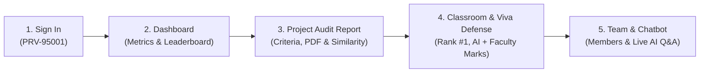

# PROVALIX AI — DEMO DATASET & PRESENTATION NAVIGATION GUIDE

This document summarizes the pre-populated presentation data and provides an exact click-by-click navigation script to present PROVALIX AI effortlessly tomorrow.

---

## 1. Demo Project Overview

### **"EcoForge AI — Intelligent Energy Optimization and Predictive Maintenance Platform"**

| Property | Details |
| :--- | :--- |
| **Title** | EcoForge AI — Intelligent Energy Optimization and Predictive Maintenance Platform |
| **Domain / Category** | Artificial Intelligence / Industrial CleanTech & Smart Energy |
| **Target Users** | Plant maintenance engineers, facility operations managers, industrial reliability teams, ESG compliance auditors |
| **Key Architecture** | High-speed edge MQTT ingestion, ISO 10816 vibration FFT wavelet anomaly engine, time-series LSTM autoencoder, Google Gemini prescriptive maintenance diagnostics, and React peak-tariff scheduler |
| **Tech Stack** | TypeScript, React, Node.js, Express, Python, PyTorch, PostgreSQL, Supabase, Prisma ORM, MQTT, Docker, Gemini API |
| **Attached Real Evidence** | `ecoforge-ai-source.zip` (4.9 KB, real TS & Python code), `ecoforge-ai-report.pdf` (3.7 KB, formal PDF report), `ecoforge-ai-presentation.pdf` (4.9 KB, landscape slides) |
| **AI Evaluation Score** | 71.0 / 100 *(Genuine Gemini AI model evaluation on uploaded evidence)* |
| **Plagiarism Audit** | **5.5% Overall Similarity (Clean)** • Source Code Similarity: 4.2% • Project Report Similarity: 6.8% • Labeled: `DEMO SIMULATION — NOT A VERIFIED PLAGIARISM RESULT` • Institutional Threshold: 15% (Well within limit) |

---

## 2. Linked Records & Schema Population

### A. Dashboard (`/dashboard`)
- **Key Metrics**: 1 Total Project, 1 Active Classroom, 1 Team, 92.0% Average Capstone Score, 4 Notifications.
- **Recent Project Audit**: Displays EcoForge AI with immediate access to the full report.
- **Classroom Leaderboard Preview**: Shows **Rank #1 for EcoForge Dynamics (92/100)** in `AI & Green Computing Capstone 2026`.
- **Upcoming Deadlines**: Active countdown timer for Capstone final submissions.

### B. Project Reports (`/project-reports` & `/project-reports/:id`)
- **Executive Summary**: Comprehensive problem definition and evaluation summary.
- **Criteria Breakdown (100 Marks Rubric)**:
  - Problem Definition (15 marks)
  - Innovation & Novelty (20 marks)
  - Technical Implementation (20 marks)
  - Functionality (15 marks)
  - Code Quality (10 marks)
  - Documentation (10 marks)
  - Overall Quality (10 marks)
- **Verified Submitted Artifacts**: Downloadable source code archive (`ecoforge-ai-source.zip`), technical report, and presentation slides.
- **Plagiarism Screening**: Multi-modal similarity audit with dynamic threshold calculation and explicit demo simulation notice.
- **Code & Technical Analysis**: Architectural review, strengths, weaknesses, and structured 2-step improvement plan.
- **PDF Export**: One-click download of the verified audit PDF certificate.

### C. Classroom (`/classrooms` & `/classrooms/:id`)
- **Classroom Name**: `AI & Green Computing Capstone 2026`
- **Unique Join Code**: `CLS-ECO26`
- **Faculty Coordinator / Owner**: Dr. Ramesh Sharma (`dr.sharma@apex.edu`, `PRV-99001`)
- **Submission Mode**: Team-based (2 to 4 members)
- **Leaderboard Standings**:
  1. **Rank #1 — EcoForge Dynamics (Alex Morgan)**: 92.0 / 100 *(Verified & Published)*
  2. **Rank #2 — CyberSentry (Priya Sharma)**: 87.5 / 100 *(Verified & Published)*
  3. **Rank #3 — AgriSense IoT (Rohan Patel)**: 83.0 / 100 *(Verified & Published)*
  4. **Rank #4 — MediFlow EHR (Ananya Iyer)**: 78.5 / 100 *(Verified & Published)*

### D. Team (`/teams` & `/teams/:id`)
- **Team Name**: `EcoForge Dynamics`
- **Team Unique Code**: `TM-ECO01`
- **Team Captain**: Alex Morgan (`PRV-95001`)
- **Active Team Members**:
  - Alex Morgan (Captain, `PRV-95001`)
  - Priya Sharma (Member, `PRV-20411`)
  - Rohan Patel (Member, `PRV-31802`)
  - Ananya Iyer (Member, `PRV-42993`)
- **Status**: Active (4 / 4 capacity)

### E. AI Chatbot (Floating Widget / Drawer)
- Powered by Google Gemini (`gemini-3.8-flash` with circuit breaker and automatic fallback to `gemini-3-flash-preview`).
- Context-Aware: Ingests authorized project details, evaluation rubric scores, team composition, upcoming classroom deadlines, and institutional guidelines.
- **Demonstration Prompts**:
  - *"Can you summarize my evaluation for EcoForge AI?"*
  - *"What are the key technical strengths of my project?"*
  - *"What is our team's standing in the classroom leaderboard?"*
  - *"What upcoming deadlines do I have?"*

---

## 3. Recommended 5-Minute Presentation Flow

### Stage 1: Authentication (30 seconds)
- Open [http://localhost:5173/login](http://localhost:5173/login).
- Highlight that students can log in using either their institutional email (`presenter.demo@provalix.ai`) or their unique Permanent ID (`PRV-95001`).
- Sign in and show the landing transition.

### Stage 2: Dashboard (1 minute)
- Point out the unified dashboard: average capstone score (92%), active team (`EcoForge Dynamics`), and recent evaluation status.
- Show the **Classroom Leaderboard Preview** displaying all 4 competitive student teams with EcoForge Dynamics at #1.

### Stage 3: Deep-Dive into Project Checker & Audit Report (1.5 minutes)
- Navigate to **Project Reports** and open **EcoForge AI**.
- Highlight:
  - The 100-mark rubric breakdown with individual progress bars and feedback.
  - The **Verified Artifacts** section showing actual uploaded ZIP and PDF files.
  - The **Multi-Modal Plagiarism & Similarity Screening**: Show the clean 5.5% rating and explain the institutional 15% threshold compliance.
  - The **Strengths, Weaknesses, and Actionable Improvement Plan**.
  - Click **Download Official PDF Report** to demonstrate the generated audit certificate.

### Stage 4: Classroom & Viva Defense Evaluation (1 minute)
- Navigate to **Classrooms** and open `AI & Green Computing Capstone 2026`.
- Point out the dual evaluation architecture:
  - **AI Engine (50 marks)**: Technical analysis, code verification, AST syntax check.
  - **Faculty Evaluator (50 marks)**: Live demo presentation (23.5/25) + 5 individual Viva questions (23.5/25).
  - Show the **Approved Verification Stamp** by Dr. Ramesh Sharma.
- Open the **Classroom Leaderboard** tab to show multi-team standings.

### Stage 5: Teams & Interactive AI Chatbot (1 minute)
- Click on **Teams** to show `EcoForge Dynamics` with its 4 linked student members.
- Open the **Provalix AI Chatbot** and ask:
  > *"Can you summarize my evaluation for EcoForge AI?"*
- Watch Gemini synthesize the project evidence in real time and explain the rubric marks.
