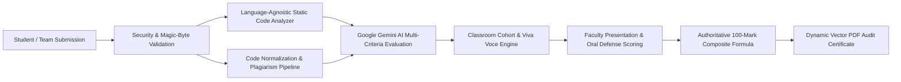

# CHAPTER 1 — INTRODUCTION

---

## 1.1 Introduction

In higher technical education worldwide, the undergraduate engineering capstone project stands as the definitive culmination of academic learning. Regulated by international accreditation bodies such as the Accreditation Board for Engineering and Technology (ABET) and the National Board of Accreditation (NBA), engineering curricula mandate substantial project-based work to demonstrate a student's competency in problem identification, technical architecture design, robust code implementation, collaborative teamwork, ethical documentation, and rigorous oral defense.

Despite its critical importance in measuring institutional educational outcomes, the actual evaluation of academic projects remains one of the most archaic, subjective, and operationally vulnerable components of higher education administration. In typical engineering institutions, faculty evaluators are burdened with grading dozens—sometimes hundreds—of complex, multi-technology project submissions within brief assessment windows lasting only a few days. Evaluators are expected to manually read lengthy project reports, inspect thousands of lines of source code across heterogeneous languages and frameworks, verify genuine execution, validate originality, detect potential code or text plagiarism, formulate insightful oral examination questions, and assign fair numerical marks across diverse student cohorts.

Under these immense operational pressures, comprehensive manual evaluation inevitably degrades. Faculty members often rely on superficial visual inspections of user interfaces, brief perusals of slide presentations, or unverified claims stated in reports. Subtle architectural flaws, fragile coding practices, lack of automated test suites, hardcoded credentials, and blatant source code plagiarism from internet repositories (such as GitHub, Kaggle, or past student submissions) routinely escape scrutiny. Furthermore, traditional oral examinations (*viva voce*) suffer from inconsistency: some students encounter perfunctory questioning while others face disproportionately difficult queries, resulting in widespread perceptions of evaluation bias and student dissatisfaction.

To address these longstanding systemic bottlenecks, this project introduces **Provalix AI — Automated Student Project Assessment Platform with Plagiarism Detection**. Provalix AI is an enterprise-grade, multi-tenant academic evaluation software platform that synergistically unites modern static program analysis, state-of-the-art Generative Artificial Intelligence (powered by Google Gemini), a tokenized code and report plagiarism scanning pipeline, an automated categorical viva-voce question generator, and a multi-role classroom cohort management framework into a unified, secure web ecosystem.

---

## 1.2 Background of the Project

The digital transformation of educational administration has accelerated rapidly over the past decade. Learning Management Systems (LMS) such as Moodle, Canvas, and Blackboard have standardized the collection of assignments, distribution of course syllabi, and recording of numerical grades. In parallel, competitive programming platforms such as LeetCode, HackerRank, and automated grading systems like Gradescope have revolutionized the assessment of introductory computer science programming tasks. These automated grading tools execute student-submitted algorithmic code snippets against pre-compiled unit test suites inside sandboxed containers, validating functional correctness on an absolute pass/fail basis.

However, the automated assessment of open-ended, complex capstone engineering projects presents an entirely different magnitude of complexity that cannot be handled by simple unit-test runners:
1. **Heterogeneous Tech Stacks**: Modern engineering capstones are not uniform scripts; they encompass full-stack web applications, distributed microservices, mobile applications, machine learning pipelines, embedded IoT firmware, and cloud databases utilizing diverse languages (TypeScript, Python, Java, C++, Go, Rust) and frameworks (React, FastAPI, Django, Spring Boot).
2. **Multi-Faceted Artifacts**: An engineering submission consists of interconnected, multi-modal deliverables: structured project documentation (PDF), slide decks (PPTX), source code archives (ZIP), version control repositories (Git), and live deployment URLs.
3. **Qualitative and Architectural Evaluation**: Grading a capstone requires evaluating qualitative dimensions that transcend pass/fail tests: Is the problem statement academically sound? Is the architecture modular? Is the code maintainable, or does it contain monolithic files and excessive nesting? Are sensitive credentials exposed? Is the work original, or is it an uncredited clone of an open-source tutorial?
4. **Defense and Knowledge Verification**: A project grade cannot rely solely on the submitted code; faculty must verify through oral viva-voce defense whether the submitting students genuinely comprehend the architecture, algorithms, and design choices or whether the code was outsourced or copied.

Until now, institutions lacked a software platform specifically tailored to synthesize these disparate requirements. Existing tools either handle simple single-file grading or generic text plagiarism without code-level semantic understanding. Provalix AI was conceived to bridge this structural chasm by establishing an automated, transparent, multi-dimensional assessment pipeline that assists faculty evaluators, ensures rigorous accreditation compliance, and provides students with immediate, actionable technical feedback.

---

## 1.3 Problem Statement

Conventional academic project evaluation processes in engineering institutions suffer from profound structural, operational, and pedagogical deficiencies:
- **Evaluator Fatigue and Subjective Discrepancies**: Manual review of complex codebases and lengthy reports across dozens of project batches leads to severe cognitive exhaustion among faculty evaluators. Consequently, grading varies wildly between different review panels and faculty members, introducing unacceptable evaluation variances for identical quality of work.
- **Inability to Perform In-Depth Code Inspection**: Due to tight evaluation time constraints, faculty rarely have time to extract student ZIP archives, inspect software architecture, check for hardcoded secrets, calculate duplication ratios, or verify code smells. Students often receive high marks for visually appealing UI templates that conceal non-functional or plagiarized backend logic.
- **Rampant, Undetected Academic Dishonesty**: Students frequently download open-source projects or purchase commercial project code, modifying superficial variables or UI labels. Traditional text-based plagiarism scanners (e.g., Turnitin) evaluate natural language prose and are fundamentally ineffective at parsing programming syntax, AST structures, or code logic.
- **Arbitrary and Inconsistent Viva-Voce Examinations**: Oral defense examinations frequently lack structured rubrics. Faculty questions are often ad-hoc, varying dramatically in technical depth and relevance. Without project-tailored technical questions, evaluators struggle to determine whether each individual student actually wrote the submitted code.
- **Fragmented Submission and Marks Attribution Workflows**: Project deliverables (reports, slide decks, ZIP archives) are scattered across emails, flash drives, and Google Drive links. Furthermore, the synthesis of marks—combining automated code quality, presentation delivery, and viva defense—is typically calculated on unstandardized manual spreadsheets prone to transcription errors.

---

## 1.4 Existing System

The existing academic project evaluation workflow across the majority of engineering colleges and universities operates as follows:
1. **Submission Phase**: Students submit physical hardbound project reports, slide presentation files, and source code on compact discs (CDs), USB drives, or shared Google Drive links.
2. **Review Panel Scheduling**: Project review committees are established. Student teams are scheduled for 15-minute review slots before a panel of 2 to 3 faculty evaluators.
3. **Manual Presentation Review**: The student team presents their slide deck and demonstrates a live execution of the software or prototype.
4. **Superficial Code Review**: If time permits, evaluators glance at a few open files in the student's IDE. No automated static analysis, dependency scanning, or duplicate line counting is executed.
5. **Ad-Hoc Oral Defense**: Faculty ask general conceptual questions based on their personal memory or immediate impression of the presentation.
6. **Spreadsheet Mark Entry**: Marks are manually recorded on paper evaluation rubrics and subsequently entered into institutional Microsoft Excel sheets by department coordinators.

---

## 1.5 Limitations of the Existing System

The traditional manual workflow exhibits critical limitations that undermine academic integrity and institutional accreditation:
1. **Zero Automated Static Code Verification**: There is no systematic extraction or verification of software metrics such as physical Lines of Code (LOC), cyclomatic complexity, excessive nesting, hardcoded credentials, or test suite presence.
2. **High Vulnerability to Code Clones**: Superficial variable renaming and comment modifications easily bypass human review, allowing plagiarized projects to receive top grades.
3. **Absence of Standardized Scoring Rubrics**: Subjective human scoring results in grade inflation or deflation depending on the specific faculty panel assigned.
4. **Lack of Instant Student Feedback**: Students receive numerical marks weeks after submission with zero diagnostic feedback regarding code quality, architectural security, or actionable technical improvements.
5. **Inefficient Faculty Time Allocation**: Evaluators spend over 75% of their review time on routine administrative tasks (verifying file completeness, calculating marks, checking basic formatting) rather than engaging in high-level intellectual mentoring.
6. **Data Fragmentation and Audit Vulnerability**: Historical submissions are lost across unindexed local drives, making it impossible to detect year-over-year project recycling between senior and junior student batches.

---

## 1.6 Proposed System

To completely overcome the limitations of the existing manual paradigm, **Provalix AI** establishes an automated, cloud-native, intelligent project assessment ecosystem. The proposed system re-engineers the academic evaluation lifecycle into a synchronized, multi-tier pipeline:

Key innovations of the proposed Provalix AI platform include:
1. **Dual Operational Modes**:
   - **Standalone Project Checker**: Enables students or researchers to upload project archives, reports, and repositories for immediate, pre-submission technical audits, 100-mark rubric breakdowns, code smell detection, and vector PDF reports.
   - **Multi-Tenant Classroom Cohorts**: Enables faculty to create academic classrooms (`CLS-XXXXX`), configure mandatory submission resources, enforce team sizes, invite co-evaluators, manage multi-member squads (`TM-XXXXX`), conduct structured viva examinations, and publish secure leaderboards.
2. **Language-Agnostic Static Code Inspection**: In-memory parsing of ZIP archives across 16+ programming languages, extracting LOC counts, language breakdown charts, dependency lists, automated test files (`jest`, `pytest`, `unittest`), duplication ratios, and code smell alerts (hardcoded API keys, deep nesting >5 levels, monolithic files).
3. **Generative AI Evaluation with Schema Constraints**: Leverages Google Gemini (`gemini-3.8-flash`) through the official `@google/genai` SDK with strict JSON schema validation, eliminating hallucinated schemas and scoring projects across seven authoritative dimensions.
4. **Structured Plagiarism and Deductions**: A pipeline that strips syntactical noise, hashes normalized code tokens, scans for duplicate structures, and calculates proportional mark deductions applied directly to the AI evaluation score.
5. **AI-Generated Categorical Viva Voce**: Automatically synthesizes five project-tailored oral defense questions spanning five core engineering domains, providing faculty with a standardized, objective oral defense rubric (max 25 marks).
6. **Authoritative 100-Mark Composite Formula**: Eliminates client-side mark tampering through a strict server-side calculation:
   $$\text{Final Grade (100)} = \text{AI Technical Score (50)} + \text{PPT/Demo Score (25)} + \text{Viva Voce Score (25)}$$
7. **Official Vector PDF Synthesis**: Server-side rendering (`pdfkit`) of publication-quality academic audit certificates featuring verification badges, category score graphs, strengths, weaknesses, and improvement roadmaps.

---

## 1.7 Objectives

The primary engineering and pedagogical objectives of Provalix AI are:
1. **Develop a Scalable, Multi-Tenant Web Platform**: Design and implement a robust, responsive web application utilizing React 18, TypeScript, TailwindCSS, Express.js, and PostgreSQL to support concurrent academic project evaluations.
2. **Implement Security-Hardened Static Program Analysis**: Engineer an in-memory extraction engine capable of safely analyzing multi-language ZIP archives while defending against zip-bomb denial-of-service attacks, path traversal exploits, and disguised executables.
3. **Integrate Structured Generative AI Evaluation**: Construct a deterministic evaluation microservice using Google Gemini 3.8 Flash that evaluates student projects against standardized 100-mark and 50-mark academic rubrics without schema corruption.
4. **Build a Code and Document Plagiarism Detection Pipeline**: Formulate an AST-inspired normalization and tokenization pipeline that calculates code and documentation similarity indices and applies justifiable grading deductions.
5. **Standardize Oral Defense via Automated Viva Generation**: Implement an intelligent questioning engine that analyzes project metadata and code evidence to formulate five targeted oral defense questions across five distinct technical competencies.
6. **Enforce Role-Based Academic Governance**: Establish strict role-based access control (RBAC) ensuring isolation between Classroom Owners, Faculty Evaluators, and Student Members, complete with permanent user IDs (`PRV-XXXXX`), team squad management, and dual-stage submission verification.
7. **Deliver Authoritative Vector PDF Reporting**: Engineer an automated reporting engine generating standardized, unalterable academic audit certificates containing comprehensive evaluation breakdowns and actionable student roadmaps.
8. **Verify System Integrity Through Comprehensive Testing**: Validate all architectural components against 27 comprehensive test suites spanning unit, integration, security, and performance verification.

---

## 1.8 Scope of the Project

### In-Scope Capabilities:
- Multi-role user management (Admin, Faculty Evaluator, Student) with permanent unique IDs (`PRV-XXXXX`).
- Standalone project auditing with immediate 100-mark feedback and downloadable PDF reports.
- Classroom cohort creation with custom join codes (`CLS-XXXXX`), enrollment workflows, and custom resource requirements.
- Team squad formation (`TM-XXXXX`) with captain governance, member invitations, and cross-classroom squad reuse.
- In-memory static code analysis supporting 16+ languages (TypeScript, JavaScript, Python, Java, C++, C, C#, Go, Rust, PHP, Ruby, HTML, CSS, SQL).
- Detection of test suites, configuration manifests (`package.json`, `requirements.txt`, etc.), and software code smells.
- Tokenized code and report similarity calculation with configurable threshold status (Low, Moderate, High).
- AI-driven viva question formulation (5 categorical questions, max 5 marks each).
- Dual-token JWT authentication (1-hour access, 7-day refresh) with bcrypt password hashing and password reset workflows.
- Vector PDF report generation via server-side streaming buffers.
- Interactive multilingual AI assistant supporting English, Tamil, Tanglish, and Hindi for academic project guidance.

### Out-of-Scope (Boundaries for Current Release):
- Sandboxed runtime dynamic code execution (e.g., executing untrusted student code inside isolated Docker containers).
- Real-time video/audio streaming during viva voce examinations (the platform facilitates oral question generation and faculty mark entry during in-person or external video viva).
- Direct bi-directional integration with proprietary legacy campus ERP databases (CSV and REST data export are supported).

---

## 1.9 Significance and Expected Benefits

The deployment of Provalix AI introduces profound benefits across the entire higher education ecosystem:
1. **For Faculty Evaluators**:
   - Reduces project evaluation time by over 70%, liberating faculty from manual file inspections and arithmetic spreadsheet entry.
   - Provides objective, pre-computed static code metrics, smell warnings, and plagiarism alerts prior to the review meeting.
   - Supplies scientifically structured viva-voce questions tailored to each student's specific codebase.
2. **For Students and Project Teams**:
   - Guarantees objective, unbiased, and transparent evaluation governed by standardized rubrics.
   - Delivers immediate, detailed diagnostic feedback identifying specific strengths, weaknesses, and concrete improvement plans.
   - Motivates students to adhere to professional coding standards, write automated tests, and eliminate hardcoded credentials.
3. **For Department Heads and Institutional Leadership**:
   - Enforces uniform grading standards across disparate review panels, eliminating grade inflation.
   - Provides permanent, centralized archival of all student project submissions, evaluation scores, and audit certificates for ABET/NBA accreditation reviews.
   - Upholds academic honesty by curbing project plagiarism and historical repository recycling.

---

## 1.10 Organization of the Report

The remainder of this academic project report is organized as follows:
- **Chapter 2 — Literature Survey**: Presents a rigorous review of published academic literature on automated assessment systems, AI-assisted grading, program analysis, code plagiarism detection algorithms, and identifies critical research gaps.
- **Chapter 3 — Materials and Methodology**: Details hardware and software requirements, system architecture, relational database design, data flow diagrams, use-case models, AI evaluation rubrics, plagiarism normalization pipelines, and security controls.
- **Chapter 4 — Proposed Work and Implementation**: Provides an in-depth, module-by-module documentation of the implemented codebase, algorithmic logic, API endpoints, backend services, and deployment architecture.
- **Chapter 5 — Results and Discussion**: Examines experimental outcomes, user interface screen flows, automated test suite executions, API performance latency benchmarks, plagiarism sensitivity analysis, and security verification.
- **Chapter 6 — Conclusion and Future Enhancements**: Summarizes the research achievements, primary contributions, current technical limitations, and outlines future engineering enhancements.
- **Final Sections**: Contains verifiable bibliographic references, Program Outcome (PO/PSO) mappings, API route catalogs, and comprehensive test execution matrices.
