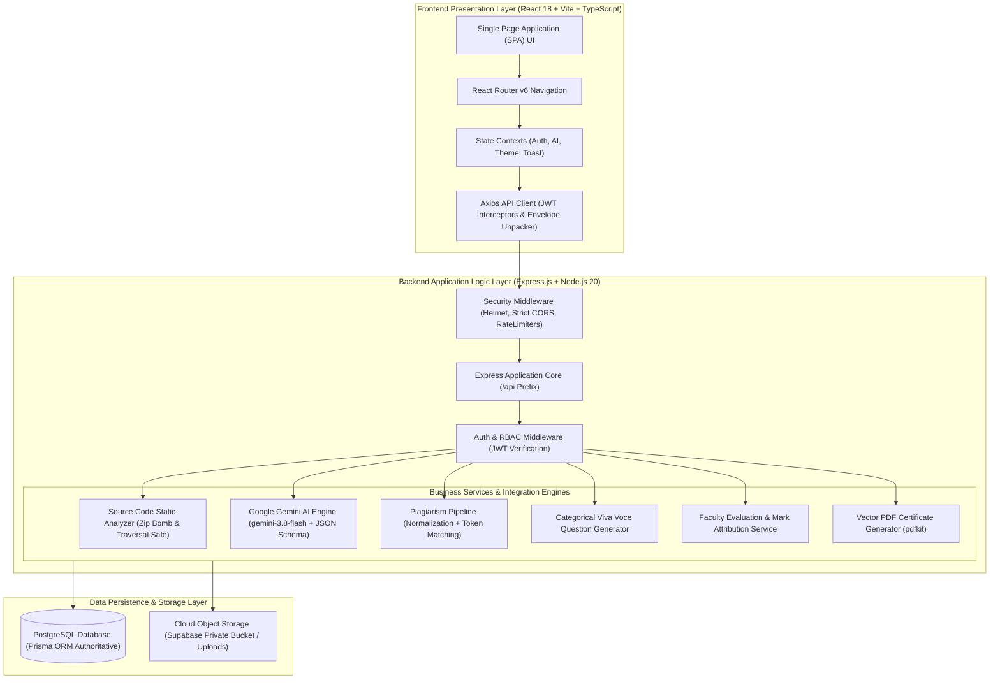
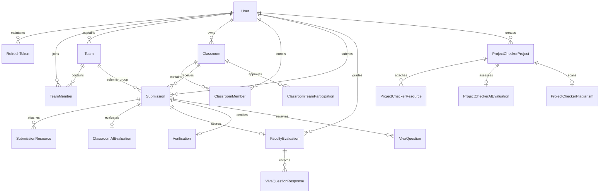
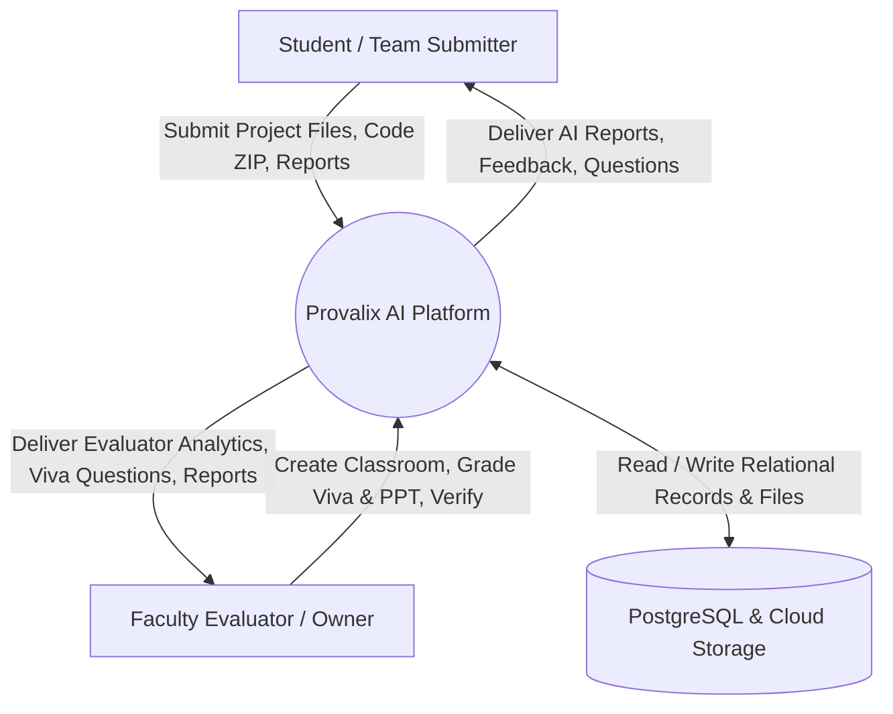
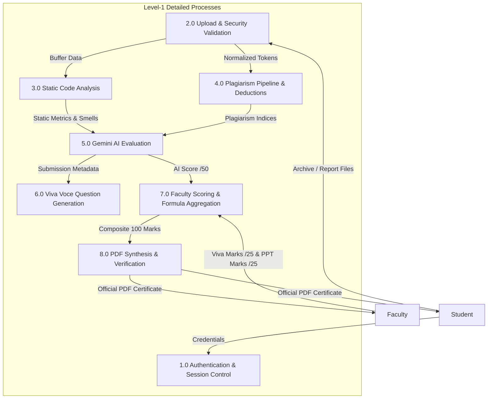
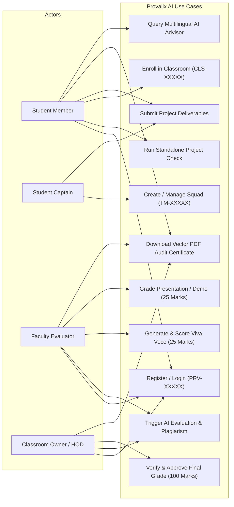
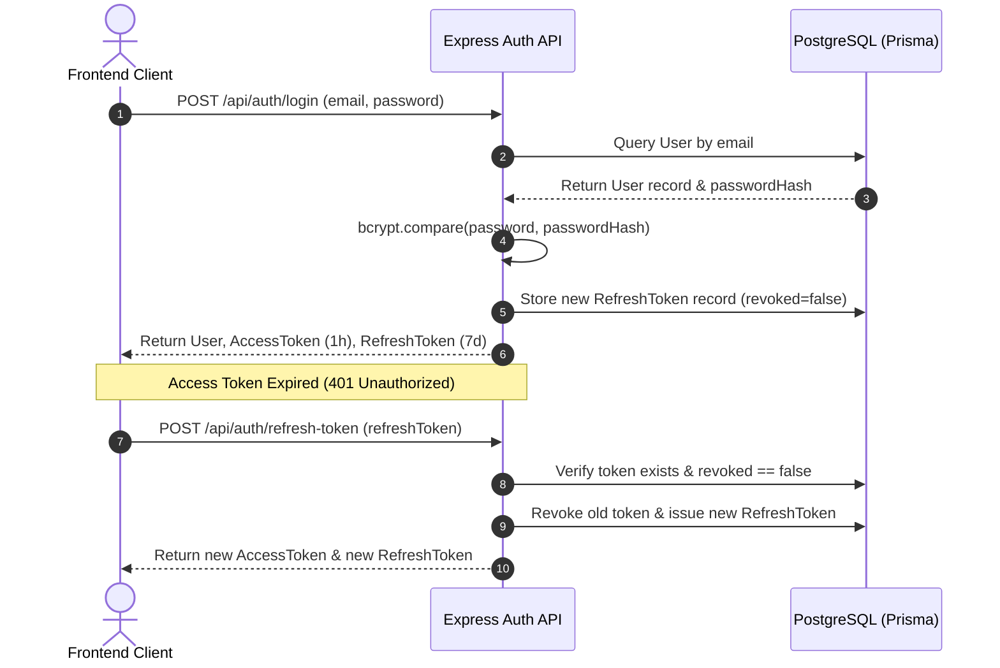
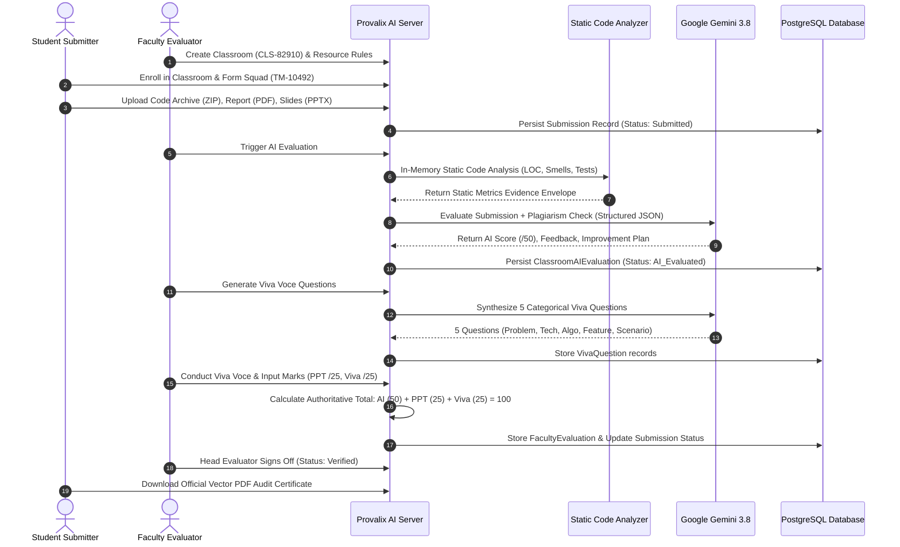

# CHAPTER 3 — MATERIALS AND METHODOLOGY

---

## 3.1 Introduction

The engineering of an enterprise-grade automated academic project assessment platform requires a rigorous, systematic methodology spanning hardware sizing, software architecture design, entity-relationship modeling, cryptographic security, static program parsing, and prompt engineering. 

This chapter details the complete materials and technical methodology employed in developing **Provalix AI**. It outlines hardware and software specifications, functional and non-functional requirements, architectural diagrams (system architecture, ER diagram, DFDs, use-case models), database schema design, the 100-mark and 50-mark AI evaluation models, the multi-stage code plagiarism pipeline, the categorical viva-voce question generation engine, and security defense mechanisms.

---

## 3.2 Hardware Requirements

The Provalix AI platform was developed, profiled, and benchmarked on modern workstation hardware and designed for deployment across standard cloud computing tiers. The hardware specifications for the development, test, and target server environments are detailed in Table 3.1.

### **TABLE 3.1: Hardware Specifications and Development Environment**

| Hardware Component | Development / Testing Specification | Recommended Production Server Specification |
| :--- | :--- | :--- |
| **Processor (CPU)** | Intel Core i7 / AMD Ryzen 7 (8 Cores, 16 Threads, $\ge$ 3.2 GHz) | Quad-Core vCPU (x86_64 or ARM64, e.g., AWS c6g.xlarge / Render Standard) |
| **Random Access Memory (RAM)** | 16 GB DDR4 / DDR5 (3200 MHz) | 8 GB to 16 GB ECC RAM |
| **Persistent Storage** | 512 GB NVMe Solid State Drive (M.2 PCIe 4.0) | 50 GB to 100 GB High-IOPS Cloud SSD Storage |
| **Network Interface** | 1 Gbps Ethernet / Wi-Fi 6 (802.11ax) | High-throughput Cloud Virtual Network Interface ($\ge$ 1 Gbps) |
| **Display / Client Resolution** | Minimum $1920 \times 1080$ Full HD | Fully Responsive (Mobile $375\text{px}$ to Desktop $4\text{K}$) |

---

## 3.3 Software Requirements

The software environment comprises modern operating systems, runtimes, package managers, and development tooling selected for high stability, cross-platform compatibility, and long-term support (LTS). Specifications are presented in Table 3.2.

### **TABLE 3.2: Software Stack and Tooling Versions**

| Software Component | Technology Name | Version | Role in Ecosystem |
| :--- | :--- | :--- | :--- |
| **Operating System** | Microsoft Windows 11 / Ubuntu Linux | 64-bit LTS | Development and host server operating system. |
| **Backend Runtime** | Node.js | `v20.18.0` LTS | Event-driven, non-blocking asynchronous JavaScript/TypeScript execution runtime. |
| **Package Manager** | Node Package Manager (`npm`) | `v10.x+` | Workspace dependency resolution and multi-package script orchestration. |
| **Frontend Framework** | React.js | `^18.3.1` | Declarative UI rendering, virtual DOM state management, and component hierarchy. |
| **Frontend Build Engine** | Vite | `^5.4.2` | Fast ES module bundling, instant hot reload, and production rollup tree-shaking. |
| **Backend API Framework** | Express.js | `^4.21.0` | HTTP routing, RESTful controller dispatch, and custom middleware pipelines. |
| **Relational Database** | PostgreSQL | `v15+` / `v16` | ACID-compliant relational persistence, foreign key indexing, and JSONB document storage. |
| **Object-Relational Mapping** | Prisma ORM (`@prisma/client`) | `^5.22.0` | Type-safe database queries, schema migrations, and connection pooling. |
| **Cloud Object Storage** | Supabase Storage Bucket | Cloud S3 API | Secure bucket storage (`provalix-uploads`) with signed access token validation. |
| **Testing Framework** | Jest & Supertest | `^29.7.0` / `^7.0.0` | Automated test runner, assertion engine, and HTTP endpoint integration mocking. |

---

## 3.4 Programming Languages and Frameworks

Provalix AI adopts **TypeScript** as its primary language across both frontend and backend tiers:
1. **TypeScript (Frontend & Backend)**: Version `5.5.3`. Provides strict compile-time type verification, preventing entire classes of runtime exceptions (`null` or `undefined` pointer dereferences). Interfaces and Data Transfer Objects (DTOs) are synchronized across API endpoints and client service layers.
2. **React 18**: Utilizes modern React paradigms including functional components, custom hooks (`useAuth`, `useAI`, `useToast`, `useTheme`), context providers, and concurrent rendering features.
3. **TailwindCSS**: Version `3.4.1`. Utility-first styling engine enforcing a clean, modern SaaS design system with consistent tokens for padding, typography, elevations, colors, and responsive breakpoints.
4. **Express.js**: Lightweight micro-framework configured with strict middleware layers for request parsing, CORS whitelisting, rate limiting, and global error handling.

---

## 3.5 Libraries, SDKs, and Development Tools

The third-party libraries and SDK dependencies integrated into the platform are detailed in Table 3.3.

### **TABLE 3.3: Core Third-Party Libraries and SDK Dependencies**

| Library / SDK | Target Tier | Verified Version | Purpose & Architectural Justification |
| :--- | :--- | :--- | :--- |
| **`@google/genai`** | Backend | `^0.1.1` | Official Google GenAI SDK for interacting with Gemini 3.8 Flash (`gemini-3.8-flash`) via structured JSON schemas. |
| **`adm-zip`** | Backend | `^0.5.16` | In-memory ZIP archive reading and extraction with programmatic entry limits and file header inspections. |
| **`pdfkit`** | Backend | `^0.15.0` | Server-side vector PDF document compiler for dynamic evaluation certificate generation. |
| **`jsonwebtoken`** | Backend | `^9.0.2` | Cryptographic issuance, signing, and verification of stateless JSON Web Tokens. |
| **`bcryptjs`** | Backend | `^2.4.3` | One-way salted hashing of user passwords enforcing computational work factors against brute force. |
| **`multer`** | Backend | `^1.4.5-lts.1` | Multipart/form-data upload middleware configured with memory storage buffers for magic-byte validation. |
| **`helmet`** | Backend | `^7.1.0` | HTTP response security header injection (HSTS, CSP, X-Frame-Options, X-Content-Type-Options). |
| **`express-rate-limit`**| Backend | `^7.4.0` | Rate-limiting middleware enforcing strict request windows on sensitive authentication and AI routes. |
| **`lucide-react`** | Frontend | `^0.441.0` | Lightweight, scalable vector iconography across the user interface. |
| **`recharts`** | Frontend | `^2.12.7` | Declarative SVG charting library rendering score distributions, category radar charts, and progress bars. |
| **`axios`** | Frontend | `^1.7.7` | Promise-based HTTP client with request/response interceptors for automatic JWT bearer injection and refresh rotation. |

---

## 3.6 Requirement Analysis

Requirement analysis was conducted by auditing evaluation guidelines from accreditation agencies (NBA/ABET) and conducting structured interviews with senior engineering faculty. The analysis established that the platform must address three distinct user roles:
- **Administrator / Classroom Owner**: Faculty members with authority to create classroom cohorts, define required submission resources, configure team size constraints, assign evaluators, and publish final verified grades.
- **Faculty Evaluator**: Designated internal or external examiners authorized to inspect submissions, trigger AI evaluations, generate and administer oral viva-voce questions, input presentation/demo marks, and submit qualitative feedback.
- **Student / Team Member**: Undergraduate candidates who create or join reusable squads, submit multi-modal project archives (code, report, slides, demo URLs), inspect evaluation reports, view improvement plans, and query the interactive AI assistant.

---

## 3.7 Functional Requirements

The core functional capabilities implemented and verified in Provalix AI are detailed in Table 3.4.

### **TABLE 3.4: Functional Requirements Specification Matrix**

| Req ID | Module / Feature | Detailed Functional Specification |
| :--- | :--- | :--- |
| **FR-01** | User Authentication | System shall support user registration, login, dual-token JWT issuance (1-hour access, 7-day refresh), and secure password reset. |
| **FR-02** | Permanent Identification| System shall assign a permanent, immutable identification number (`PRV-XXXXX`) to every registered user upon account creation. |
| **FR-03** | Standalone Project Audit | System shall permit users to upload a ZIP archive, PDF report, and presentation slides for an immediate 100-mark AI technical audit. |
| **FR-04** | Static Code Analysis | System shall parse ZIP archives in memory across 16+ languages, calculating LOC, language distributions, dependencies, smells, and test presence. |
| **FR-05** | Security Hardening | System shall reject ZIP archives exceeding 2,000 files, 100 MB uncompressed, or containing path traversal tokens (`..`, `/`, `\0`). |
| **FR-06** | Plagiarism Pipeline | System shall normalize code snippets, calculate code and report similarity indices, and compute justifiable mark deductions. |
| **FR-07** | Classroom Governance | System shall allow faculty to create classrooms with join codes (`CLS-XXXXX`), enforce submission deadlines, and configure resource rules. |
| **FR-08** | Team Squad Management | System shall support cross-classroom reusable squads (`TM-XXXXX`) with captain leadership, permanent ID invitations, and member limits. |
| **FR-09** | AI Classroom Evaluation | System shall evaluate classroom submissions against a 50-mark rubric via Google Gemini, incorporating plagiarism penalties. |
| **FR-10** | Viva Voce Generation | System shall automatically synthesize 5 project-tailored oral defense questions across 5 academic pillars, max 5 marks each (25 total). |
| **FR-11** | Composite Mark Formula | System shall calculate the authoritative final grade: $\text{Final Score (100)} = \text{AI (50)} + \text{PPT/Demo (25)} + \text{Viva (25)}$. |
| **FR-12** | Dual-Stage Verification | System shall require Classroom Owners to officially approve, return, or request revisions on evaluated student submissions. |
| **FR-13** | Vector PDF Synthesis | System shall generate publication-quality vector PDF evaluation certificates containing scores, badges, and improvement roadmaps. |
| **FR-14** | Interactive AI Assistant | System shall provide a contextual RAG-enabled AI tutor supporting multilingual responses in English, Tamil, Tanglish, and Hindi. |
| **FR-15** | Leaderboard & Privacy | System shall display ranked classroom leaderboards while strictly concealing private peer evaluation reports from unauthorized students. |

---

## 3.8 Non-Functional Requirements

Table 3.5 outlines the non-functional criteria governing system performance, security, and reliability.

### **TABLE 3.5: Non-Functional Requirements and System Quality Metrics**

| Quality Attribute | Metric / Specification | Architectural Mechanism Enforcing Requirement |
| :--- | :--- | :--- |
| **Performance Latency** | Static code analysis $\le 1.5\text{s}$ for archives $< 25\text{MB}$. API health response $\le 50\text{ms}$. | In-memory stream parsing with `adm-zip`, asynchronous I/O, and indexed PostgreSQL queries. |
| **Security & Privacy** | OWASP Top 10 compliance; zero plaintext secrets in storage or logs. | Bcrypt hashing ($10\text{ rounds}$), Helmet security headers, signed Supabase URLs, strict CORS whitelist. |
| **Reliability & Backoff** | Resilient AI evaluation handling transient errors and quota limits. | Bounded exponential retry backoff, HTTP 429 quota classification (`DAILY_FREE_TIER`, `RPM_LIMIT`), clean fallback. |
| **Data Integrity** | ACID transaction compliance across relational entities. | Prisma ORM foreign key cascading, unique constraints (`email`, `permanentId`, `code`), transaction blocks. |
| **Maintainability** | Clean architecture; separation of concerns. | Modular layered structure: Routes $\rightarrow$ Controllers $\rightarrow$ Services $\rightarrow$ Repositories $\rightarrow$ Database. |
| **Portability & Responsive** | Accessible on modern web browsers (Chrome, Firefox, Safari, Edge). | Responsive TailwindCSS layout system supporting viewports from $375\text{px}$ to $4\text{K}$. |

---

## 3.9 System Architecture

Provalix AI is designed following a **3-Tier Layered Service-Oriented Architecture (SOA)**, separating presentation, business logic, and persistence into isolated, loosely coupled layers. Figure 3.1 illustrates the high-level system architecture.

*(Figure 3.1: Provalix AI 3-Tier Layered System Architecture)*

---

## 3.10 Module Design

The system is decomposed into eight cohesive functional modules:
1. **Authentication & Identity Module**: Manages user registration, bcrypt password hashing, permanent ID (`PRV-XXXXX`) issuance, dual-token JWT signing, token rotation, and password reset flows.
2. **Static Code Analysis Module**: Inspects uploaded code archives in memory without runtime execution, calculating LOC, multi-language breakdown, dependencies, automated tests, duplication ratios, and code smells.
3. **AI Evaluation Microservice**: Interacts with Google Gemini 3.8 Flash using structured JSON schemas, scoring submissions across defined rubric dimensions and generating actionable improvement plans.
4. **Plagiarism & Similarity Pipeline**: Normalizes source code by removing syntactic noise and hashes token sequences to calculate code and document similarity indices with proportional mark deductions.
5. **Classroom Cohort Module**: Enables faculty to create academic classrooms (`CLS-XXXXX`), enforce resource rules, invite co-evaluators, and manage student submissions.
6. **Team & Squad Management Module**: Provides cross-classroom reusable student squads (`TM-XXXXX`) governed by student captains with invitation-based membership controls.
7. **Viva Voce Oral Defense Engine**: Analyzes submission metadata to generate five project-specific oral examination questions across five core competencies (max 25 marks).
8. **Dynamic Vector PDF Reporting Module**: Synthesizes multi-page, publication-quality academic evaluation certificates via `pdfkit` stream buffers.

---

## 3.11 Database Design and Entity Relationships

The relational database architecture is defined in Prisma ORM (`backend/prisma/schema.prisma`) targeting PostgreSQL. Figure 3.2 depicts the Entity-Relationship (ER) diagram, and Table 3.6 describes the primary table entities.

*(Figure 3.2: Relational Database Entity-Relationship Diagram)*

### **TABLE 3.6: Database Table Entities and Primary Schema Attributes**

| Table Entity | Primary Key | Key Foreign Keys | Purpose & Essential Data Fields |
| :--- | :--- | :--- | :--- |
| **`User`** | `id` (UUID) | None | Core user account: `permanentId` (`PRV-XXXXX`), `email`, `passwordHash`, `name`, `department`, `college`. |
| **`RefreshToken`** | `id` (UUID) | `userId` | Active JWT refresh tokens: `token`, `expiresAt`, `revoked`. |
| **`Classroom`** | `id` (UUID) | `ownerId` $\rightarrow$ `User` | Academic cohorts: `code` (`CLS-XXXXX`), `name`, `submissionMode`, `minTeamSize`, `maxTeamSize`, `deadline`. |
| **`Team`** | `id` (UUID) | `captainId` $\rightarrow$ `User` | Student squads: `code` (`TM-XXXXX`), `name`, `maxSize`, `status`. |
| **`Submission`** | `id` (UUID) | `classroomId`, `submitterId`, `teamId` | Project deliverables: `title`, `description`, `technologies`, `status`, `finalTotalScore` (100). |
| **`ClassroomAIEvaluation`**| `id` (UUID) | `submissionId` | AI evaluation: `rawScore` (/50), `similarity`, `deduction`, `finalScore` (/50), `feedback`, `improvementPlan`.|
| **`FacultyEvaluation`**| `id` (UUID) | `submissionId`, `evaluatorId` | Faculty marks: `pptDemoScore` (/25), `vivaTotalScore` (/25), `totalFacultyScore` (/50), `feedback`. |
| **`VivaQuestion`** | `id` (UUID) | `submissionId` | Tailored questions: `questionNumber` (1-5), `category`, `questionText`, `maxScore` (5.0). |
| **`VivaQuestionResponse`**| `id` (UUID) | `facultyEvaluationId` | Oral defense marks: `questionNumber`, `score` (0-5.0), `feedback`. |
| **`Verification`** | `id` (UUID) | `submissionId`, `verifiedById`| Dual-stage sign-off: `status` (Approved/Returned), `returnReason`, `verifiedAt`. |

---

## 3.12 Data Flow Design

Data flow within Provalix AI proceeds through structured hierarchy levels. Figure 3.3 illustrates the Level-0 Context Level DFD, and Figure 3.4 illustrates the Level-1 Detailed Process DFD.

*(Figure 3.3: Level-0 Context Level Data Flow Diagram)*

*(Figure 3.4: Level-1 Detailed Process Data Flow Diagram)*

---

## 3.13 Use Case Design

The comprehensive system use case model is presented in Figure 3.5, delineating user roles and accessible system boundaries.

*(Figure 3.5: Comprehensive System Use Case Diagram)*

---

## 3.14 Implementation Methodology

The platform was built following an **Agile Test-Driven Iteration (TDD)** lifecycle comprising four execution phases:
1. **Foundation & Data Layer**: Database modeling with Prisma, PostgreSQL migration scripts, seed data generation, and JWT authentication service implementation.
2. **Analysis & Core Processing Engines**: Engineering the in-memory static code analyzer, magic-byte upload interceptor, zip-bomb defense filter, and code normalization pipeline.
3. **AI & Service Integration**: Implementing the Google GenAI Gemini 3.8 Flash client with JSON schema validation, viva-voce question generator, PDFKit synthesis engine, and Supabase storage driver.
4. **Frontend Architecture & Verification**: Constructing the Vite / React single-page application, TailwindCSS design tokens, responsive layout dashboards, Recharts analytics, and executing 27 end-to-end automated test suites.

---

## 3.15 AI Evaluation Methodology and Prompt Engineering

To guarantee grading objectivity and eliminate LLM hallucination, Provalix AI implements **Ground-Truth Pre-Extraction**. Before invoking the AI model, the backend static analyzer inspects the submitted codebase and generates an **Evidence Context Envelope**:
- Verified Lines of Code (LOC) and primary language distribution,
- Detected configuration files (`package.json`, `tsconfig.json`, `requirements.txt`, `Dockerfile`),
- Automated test suites (`jest`, `pytest`, `unittest`) and test file counts,
- Documented README summaries,
- Static code smells (hardcoded secrets, excessive nesting > 5 levels, monolithic files > 300 LOC),
- Calculated line duplication percentage.

The Gemini 3.8 Flash model is invoked via `@google/genai` with a strict JSON schema restricting the response payload to predefined numeric fields and feedback strings. Table 3.7 details the authoritative 100-mark rubric dimensions enforced by the platform.

### **TABLE 3.7: 100-Mark AI Project Checker Authoritative Rubric Dimensions**

| Rubric Dimension | Max Score | Evaluation Criteria & Evidence Inspected |
| :--- | :---: | :--- |
| **Problem Definition** | 15 Marks | Clarity of problem statement, objective alignment, feasibility, and societal/engineering relevance. |
| **Innovation & Novelty** | 20 Marks | Originality of approach, modern architectural paradigms, creative technical contributions. |
| **Technical Implementation** | 20 Marks | Architectural modularity, correct framework usage, database schema normalization, API design. |
| **Functionality** | 15 Marks | Working feature completeness, edge-case resilience, live demo availability, user flow coherence. |
| **Code Quality** | 10 Marks | Adherence to clean code, low cyclomatic nesting, modular file lengths, zero hardcoded secrets. |
| **Documentation** | 10 Marks | Comprehensiveness of report, architectural diagrams, API documentation, installation instructions. |
| **Overall Feasibility** | 10 Marks | Practical deployability, automated test coverage presence, future scalability, ethical considerations. |
| **Total Composite Score**| **100 Marks**| **Mathematically aggregated by backend server ($15+20+20+15+10+10+10 = 100$).** |

---

## 3.16 Plagiarism Detection and Normalization Pipeline

The plagiarism pipeline operates across four discrete stages:
1. **Source & Report Extraction**: Text content is extracted from project documentation, descriptions, and code files extracted from submitted ZIP archives.
2. **Code Normalization**: Source code snippets are stripped of syntactical trivia:
   - All single-line (`//`, `#`) and multi-line (`/* ... */`) comments are eliminated.
   - Whitespace, tabs, and newline sequences are normalized to single-space tokens.
   - Variable and function identifier tokens are generalized to uniform lexical symbols (`ID_TOKEN`).
3. **Token Hashing & Similarity Matching**: Normalized token streams are processed through a sliding window n-gram algorithm. Generated hashes are compared against the cohort repository corpus using Jaccard index similarity:
   $$J(A, B) = \frac{|A \cap B|}{|A \cup B|}$$
4. **Deduction Attribution**: Overall similarity percentages are categorized into risk tiers:
   - **Low Risk ($\le 15\%$)**: $0\text{ marks deduction}$.
   - **Moderate Risk ($16\% - 35\%$)**: Proportional penalty ($2\text{ to }5\text{ marks deduction}$).
   - **High Risk ($> 35\%$)**: Severe penalty ($\ge 10\text{ marks deduction}$ with mandatory faculty audit flag).
   Deductions are applied directly into the AI evaluation score:
   $$\text{Final AI Score} = \max(0, \, \text{Raw AI Score} - \text{Plagiarism Deduction})$$

---

## 3.17 Viva-Voce Question Generation Methodology

To standardize the oral defense examination, Provalix AI implements an automated **Categorical Viva Voce Engine**. The engine inspects the project's declared technologies, problem statement, and static code evidence to synthesize exactly five tailored technical questions distributed across five academic pillars. Table 3.8 outlines the viva voce rubric.

### **TABLE 3.8: 5-Category Viva Voce Oral Defense Question Rubric**

| Question # | Category / Pillar | Targeted Technical Competency | Max Score |
| :---: | :--- | :--- | :---: |
| **Q1** | **Problem Understanding** | Evaluates student comprehension of underlying domain requirements, constraints, and target user needs. | 5.0 Marks |
| **Q2** | **Technical Implementation** | Inquires into specific data structures, algorithms, state management, and API design choices. | 5.0 Marks |
| **Q3** | **Technology / Algorithm Choice** | Challenges students to justify why specific libraries, databases, or algorithms were chosen over alternatives. | 5.0 Marks |
| **Q4** | **Feature / Internal Working** | Probes internal execution mechanics, transaction lifecycles, and backend data flow operations. | 5.0 Marks |
| **Q5** | **Scenario & Failure Handling** | Tests candidate readiness for edge cases, error recovery, network latency, and security threats. | 5.0 Marks |
| **Total** | **Oral Viva Voce Total** | **Sum of 5 Category Scores ($5 \times 5.0\text{ marks}$)** | **25.0 Marks** |

---

## 3.18 Authentication, Authorization, and Security Controls

The platform employs a hardened cryptographic security model:
1. **Dual-Token JWT Rotation**: Upon successful login, the server issues a short-lived Access Token (1-hour expiry, signed with SHA-256 HMAC) and a long-lived Refresh Token (7-day expiry). The refresh token is stored in the PostgreSQL database. When the access token expires, the client calls `/api/auth/refresh-token`, rotating the refresh token and invalidating the prior token to prevent replay attacks (Figure 3.6).
2. **Password Cryptography**: Passwords are salted and hashed using `bcryptjs` with a work factor of 10.
3. **Zip-Bomb & Traversal Defense**: The in-memory extraction pipeline checks archive headers prior to decompression:
   - If total entries exceed $2,000$, extraction stops.
   - If uncompressed size exceeds $100\text{ MB}$, extraction terminates.
   - If any file path contains `..`, leading `/`, or null bytes (`\0`), the entry is rejected.
4. **Magic-Byte Header Validation**: File uploads are inspected in memory buffers to verify magic-byte headers, blocking disguised executables (`.exe`, `.bat`, `.sh`, `.dll`).

*(Figure 3.6: Dual-Token JWT Authentication and Rotation Workflow)*

---

## 3.19 Testing and Quality Assurance Methodology

The quality assurance methodology enforces test-driven validation across four distinct test levels:
1. **Unit Testing**: Isolated verification of individual functions (e.g., static code analysis heuristics, zip-bomb entry limiters, code normalizers, mark calculation formulas).
2. **Integration Testing**: Testing communication between Express controllers, Prisma ORM, and PostgreSQL transactions.
3. **Security Testing**: Verification of CORS headers, rate limiters, token expiration, path traversal mitigations, and RBAC role protections.
4. **End-to-End Workflow Testing**: Validating the complete evaluation lifecycle from classroom creation through submission, AI scoring, viva grading, verification, and PDF certificate export.

Automated test execution is managed using **Jest** and **Supertest** spanning 27 test files.

---

## 3.20 Complete End-to-End System Workflow

The integrated lifecycle of an academic project evaluation within Provalix AI is depicted in Figure 3.7.

*(Figure 3.7: Complete End-to-End System Workflow)*
