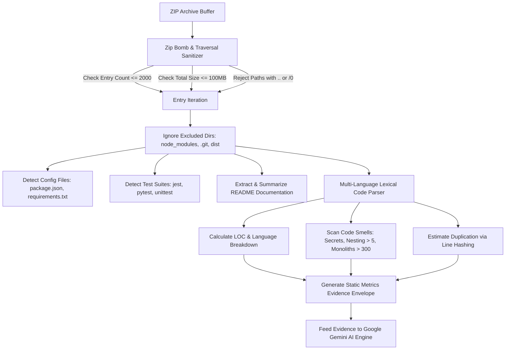
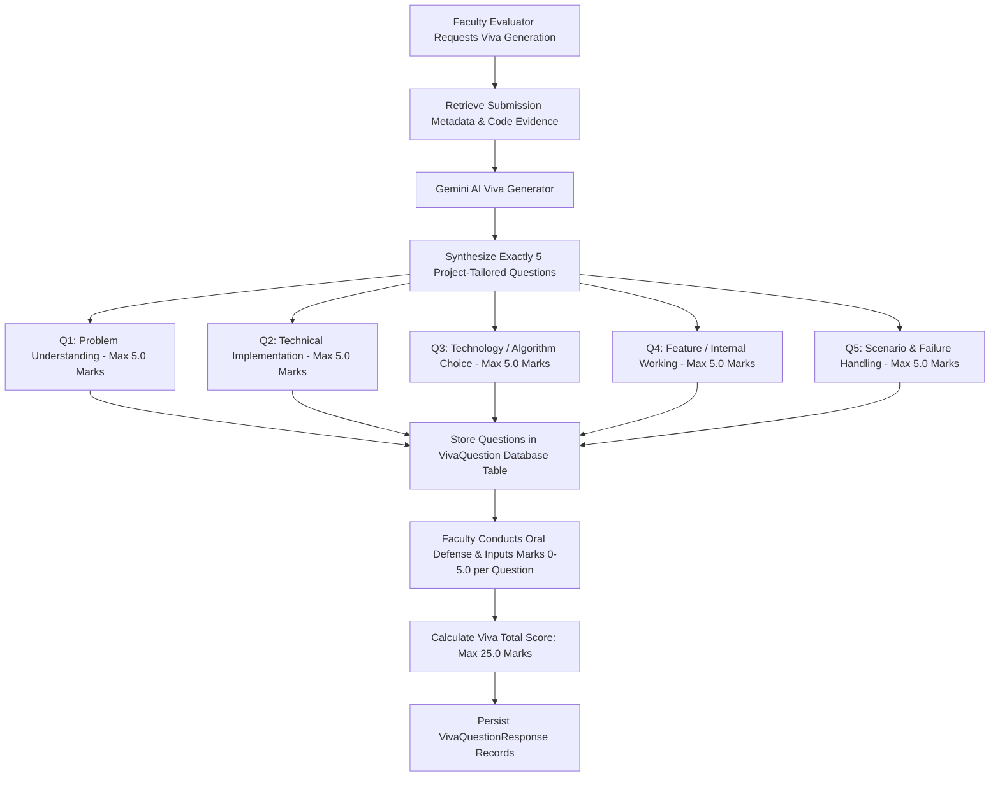
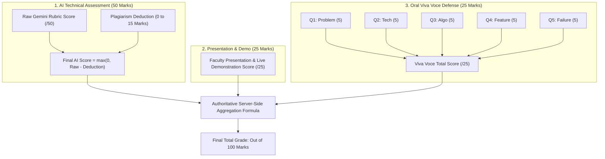
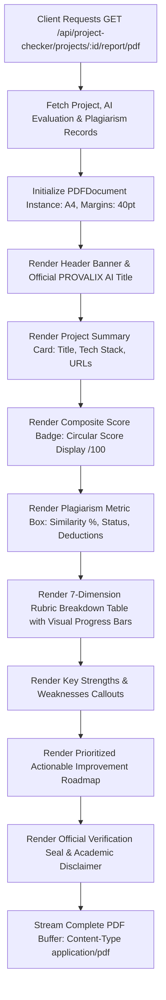

# CHAPTER 4 — PROPOSED WORK AND IMPLEMENTATION

---

## 4.1 Proposed System Overview

**Provalix AI** is engineered as a cloud-native, modular web platform designed to streamline, automate, and standardize the evaluation of academic engineering capstones and classroom projects. The implementation bridges the divide between static code metrics and qualitative AI reasoning, providing faculty with an objective, evidence-based assessment suite while giving students instant diagnostic feedback.

The software implementation spans two major repositories:
- `backend/`: A TypeScript / Express.js RESTful API engine managing authentication, in-memory static program analysis, Google Gemini AI integration, plagiarism scanning, viva-voce generation, PDF report generation, and PostgreSQL persistence via Prisma ORM.
- `frontend/`: A React 18 single-page application (SPA) built using Vite and TypeScript, featuring a SaaS design system styled with TailwindCSS, Lucide React icons, and Recharts interactive visualizations.

Table 4.1 outlines the primary system modules and their corresponding architectural source files.

### **TABLE 4.1: Primary System Modules and Codebase Architecture**

| Module Identifier | Primary Source Implementation Files | Architectural Responsibility |
| :--- | :--- | :--- |
| **Authentication & Users** | `backend/src/services/authService.ts`<br>`frontend/src/context/AuthContext.tsx` | Permanent ID allocation (`PRV-XXXXX`), registration, dual-token JWT signing, bcrypt password hashing. |
| **Static Code Analyzer** | `backend/src/services/sourceCodeAnalyzer.ts` | In-memory ZIP archive parsing, language distribution, LOC counts, code smell detection, zip-bomb defense. |
| **Gemini AI Integration** | `backend/src/integrations/ai/GeminiProvider.ts`<br>`backend/src/services/aiEvaluationService.ts` | Multi-dimensional rubric evaluation via `@google/genai` (Gemini 3.8 Flash) with structured JSON schemas. |
| **Plagiarism Pipeline** | `backend/src/integrations/plagiarism/*` | Source extraction, code normalization, n-gram hashing, similarity calculation, and rubric deductions. |
| **Classroom Cohorts** | `backend/src/services/classroomService.ts`<br>`frontend/src/pages/app/ClassroomsPage.tsx` | Classroom lifecycle (`CLS-XXXXX`), join code enrollment, required resource enforcement, role management. |
| **Team / Squad Engine** | `backend/src/services/teamService.ts`<br>`frontend/src/pages/app/TeamsPage.tsx` | Reusable squads (`TM-XXXXX`), captain governance, permanent ID invitations, and member limits. |
| **Viva Voce Engine** | `backend/src/services/vivaService.ts`<br>`frontend/src/pages/app/ClassroomEvaluationsPage.tsx` | AI generation of 5 categorical oral questions across 5 pillars, max 5 marks each (25 marks total). |
| **Faculty Evaluation** | `backend/src/services/facultyEvaluationService.ts` | Authoritative 100-mark formula: AI (50) + Presentation/Demo (25) + Viva (25) = 100. |
| **Vector PDF Reports** | `backend/src/services/pdfReportGenerator.ts` | Server-side vector PDF report streaming (`pdfkit`) with official stamps, charts, and improvement roadmaps. |
| **Multilingual AI Tutor** | `backend/src/services/aiService.ts`<br>`frontend/src/components/ai/AIAssistantDrawer.tsx` | Interactive RAG educational assistant supporting English, Tamil, Tanglish, and Hindi. |

---

## 4.2 Overall System Architecture Implementation

The platform architecture follows clean architectural principles where business rules are decoupled from external frameworks and delivery mechanisms.

The backend lifecycle initiates in `backend/src/app.ts`, orchestrating middleware in strict security sequence:
1. **Security Headers**: `helmet()` injects standard HTTP security headers (disabling X-Powered-By, enforcing HSTS, CSP, and X-Content-Type-Options).
2. **CORS Validation**: Strict environment origin whitelisting (`CORS_ORIGIN=http://localhost:5173`) ensures credentials and headers are accepted only from authorized client domains.
3. **Rate Limiting**: Configured using `express-rate-limit`:
   - `globalLimiter`: 100 requests per 15-minute window for standard endpoints.
   - `authLimiter`: 10 requests per 15-minute window to thwart credential stuffing attacks.
   - `aiLimiter`: 15 requests per 15-minute window to protect LLM quota limits.
4. **Request Body Parsing**: `express.json({ limit: '10mb' })` and `express.urlencoded({ extended: true, limit: '10mb' })`.
5. **API Prefix Routing**: All resource routers are registered under `/api` (`/auth`, `/classrooms`, `/teams`, `/submissions`, `/project-checker`, `/users`, `/notifications`, `/chatbot`, `/storage`).
6. **Health Probes**:
   - `GET /health`: Lightweight probe returning `{ status: "ok", timestamp: ... }` for cloud load balancer health checks.
   - `GET /api/health`: Comprehensive diagnostic endpoint checking PostgreSQL database connectivity and active AI provider status.
7. **Global Error Handler**: Intercepts operational `AppError` instances, formatting clean JSON error responses while suppressing internal stack traces in production.

---

## 4.3 Authentication and User Management Module

The authentication engine is implemented in `backend/src/services/authService.ts`. It manages the user lifecycle from registration to session revocation.

### 1. Permanent Identification Number (`PRV-XXXXX`)
Upon registration, every user is assigned a permanent, human-readable identifier formatted as `PRV-XXXXX` (e.g., `PRV-10482`). This ID serves as a unique public identifier for classroom enrollments and team squad invitations, preventing the exposure of internal database UUIDs.

```typescript
// Permanent ID Generation Logic (backend/src/services/authService.ts)
private generatePermanentId(): string {
  const randomNum = Math.floor(10000 + Math.random() * 90000);
  return `PRV-${randomNum}`;
}
```

### 2. Dual-Token JWT Session Architecture
To balance user convenience with high security, Provalix AI implements dual-token rotation:
- **Access Token**: Short-lived (1 hour), signed with `JWT_SECRET`, containing `{ userId, email, permanentId, role }`.
- **Refresh Token**: Long-lived (7 days), signed with `JWT_REFRESH_SECRET`, persisted in the PostgreSQL `RefreshToken` table with `expiresAt` and `revoked` boolean flags.
- **Rotation Workflow**: When an access token expires, the client calls `POST /api/auth/refresh-token`. The server validates the existing refresh token, flags it as `revoked: true`, generates a fresh refresh token, and issues a new access token, preventing token replay attacks.

---

## 4.4 Standalone Project Checker Module

The Project Checker module (`backend/src/services/projectCheckerService.ts` and `frontend/src/pages/app/NewProjectCheckPage.tsx`) provides an instant, pre-submission audit environment. Students or faculty can submit:
1. Source Code Archive (ZIP file) or direct source files,
2. Project Documentation Report (PDF),
3. Presentation Slide Deck (PPTX / PDF),
4. Project metadata (Title, Problem Statement, Objectives, Technologies, GitHub URL, Live Demo URL).

Upon submission, the controller parses uploaded files in memory, invokes the Static Code Analyzer, executes the Plagiarism Pipeline, triggers the 100-mark Google Gemini evaluation, and stores the results in `ProjectCheckerProject`, `ProjectCheckerAIEvaluation`, and `ProjectCheckerPlagiarism` tables. Users can immediately inspect their multidimensional score breakdown, review code smells, and download an official PDF report.

---

## 4.5 Language-Agnostic Source Code Static Analyzer

The **Source Code Static Analyzer** (`backend/src/services/sourceCodeAnalyzer.ts`) is a foundational innovation of Provalix AI. It performs deep, language-agnostic static program analysis on submitted ZIP archives entirely in memory, without executing untrusted code or spawning unsafe child processes. Figure 4.1 depicts the static analyzer workflow.


*(Figure 4.1: Static Source Code Analyzer In-Memory Parsing Pipeline)*

### 1. Adversarial File Hardening (Zip-Bomb & Traversal Protection)
To defend the backend server against denial-of-service (DoS) attacks and remote file overwrite exploits, `SourceCodeAnalyzer.ts` enforces four strict security limits:
- `MAX_ZIP_ENTRIES = 2000`: If an archive contains more than 2,000 entries, only the first 2,000 are inspected.
- `MAX_TOTAL_UNCOMPRESSED_BYTES = 100 * 1024 * 1024` (100 MB): Halts extraction if the aggregate decompressed payload exceeds 100 MB.
- `MAX_ENTRY_BYTES = 5 * 1024 * 1024` (5 MB): Skips individual file entries exceeding 5 MB.
- **Path Traversal Defense**: Quarantines and rejects entries containing path traversal markers (`..`, leading `/`, or null bytes `\0`).

### 2. Multi-Language Support
The static analyzer maps file extensions across 16+ programming languages (Table 4.2).

### **TABLE 4.2: Supported Programming Languages in Static Code Analyzer**

| Programming Language | Extensions Recognized | Analysis Capabilities |
| :--- | :--- | :--- |
| **TypeScript / TSX** | `.ts`, `.tsx` | LOC, interface declarations, nesting depth, React component smells. |
| **JavaScript / JSX** | `.js`, `.jsx` | LOC, line hashing duplication, dependency manifest parsing (`package.json`). |
| **Python** | `.py` | LOC, virtual env exclusion, dependency parsing (`requirements.txt`, `Pipfile`). |
| **Java** | `.java` | LOC, class-level line analysis, build manifest parsing (`pom.xml`, `build.gradle`). |
| **C / C++** | `.c`, `.cpp` | LOC, header analysis, nesting inspection, monolith file checks. |
| **C#** | `.cs` | LOC, namespace parsing, indentation smells. |
| **Go** | `.go` | LOC, module file detection (`go.mod`), nesting depth checks. |
| **Rust** | `.rs` | LOC, Cargo manifest detection (`Cargo.toml`), complexity smells. |
| **PHP / Ruby** | `.php`, `.rb` | LOC, script parsing, hardcoded credential detection. |
| **HTML / CSS / SQL** | `.html`, `.css`, `.sql` | Structural LOC, styling file counting, query script line tracking. |

### 3. Automated Code Smell Detection
The analyzer inspects source lines for three critical software engineering code smells:
- **Hardcoded Secret Detection**: Regular expression scanning detecting plaintext API keys, passwords, private tokens, and database secrets:
  ```typescript
  /(?:password|passwd|secret|api_key|apikey|access_token|private_key)\s*[:=]\s*["'][a-zA-Z0-9_-]{8,}["']/i
  ```
- **Excessive Nesting Smell**: Flags functions with leading indentation exceeding 20 spaces (>5 levels of nested `if`/`for`/`while` blocks), signaling high cyclomatic complexity.
- **Monolithic File Smell**: Flags source files containing more than 300 physical lines of code, recommending modularization into smaller cohesive components.

---

## 4.6 AI Evaluation Micro-Service and Rubric Enforcement

The AI evaluation microservice is governed by `backend/src/integrations/ai/GeminiProvider.ts` and `backend/src/services/aiEvaluationService.ts`.

### 1. Google Gemini 3.8 Flash Integration
The platform initializes the official Google GenAI SDK (`@google/genai`) configured with model `gemini-3.8-flash`. Calls are executed with bounded retries and exponential backoff:
- **Transient Error Recovery**: HTTP 503, network timeouts (`ECONNRESET`, `ETIMEDOUT`), and transient 429 rate limits invoke a bounded retry loop (2 attempts max).
- **Quota Error Classification**: The service dynamically categorizes HTTP 429 quota exceptions into `DAILY_FREE_TIER`, `RPM_LIMIT`, `TOKEN_LIMIT`, and `TEMPORARY_RATE_LIMIT`, reporting actionable user-facing error messages.
- **Development Fallback**: In offline development environments lacking active API keys, the system gracefully engages `MockAIProvider.ts`, generating realistic rubric scores and feedback.

### 2. Evidence Context Grounding
The AI prompt is grounded in verified static code metrics extracted during Phase 1:
```typescript
// Context Construction (backend/src/integrations/ai/GeminiProvider.ts)
const evidenceSummary = `
[GROUND TRUTH STATIC CODE EVIDENCE]
- Source Available: ${evidence.sourceAvailable}
- Physical LOC: ${evidence.lineCount} across ${evidence.fileCount} files
- Primary Language: ${evidence.primaryLanguage}
- Test Suite Detected: ${evidence.hasTests} (${evidence.testFileCount} test files)
- Documentation Found: ${evidence.hasDocumentation}
- Code Smells: ${evidence.codeSmells.map(s => s.rule + ': ' + s.message).join('; ')}
- Duplication Ratio: ~${evidence.duplicationPercentage}%
`;
```

---

## 4.7 Plagiarism Detection and Similarity Scorer

The plagiarism detection architecture (`backend/src/integrations/plagiarism/`) executes a multi-stage analysis pipeline depicted in Figure 4.2.

```mermaid
graph TD
    A[Submitted Resources: Code ZIP & Report PDF] --> B[Source & Text Extractor]
    B --> C[Code Normalizer: Strip Comments & Standardize Whitespace]
    C --> D[Token Generalization: Replace Identifiers with ID_TOKEN]
    D --> E[N-Gram Sliding Window Hash Generator]
    E --> F[Cohort Repository Corpus Matching]
    F --> G[Calculate Code & Document Similarity Indices]
    G --> H{Determine Risk Tier}
    H -->|Similarity <= 15%| I[Status: Low Risk | 0 Mark Deduction]
    H -->|16% to 35%| J[Status: Moderate Risk | Proportional 2-5 Mark Deduction]
    H -->|> 35%| K[Status: High Risk | >= 10 Mark Deduction + Audit Flag]
    I --> L[Apply Deduction Directly to AI Evaluation Score]
    J --> L
    K --> L
```
*(Figure 4.2: Multi-Stage Code Normalization and Plagiarism Detection Pipeline)*

### 1. Code Normalization Algorithm (`codeNormalizer.ts`)
```typescript
export class CodeNormalizer {
  normalize(code: string): string {
    return code
      // 1. Strip block comments
      .replace(/\/\*[\s\S]*?\*\//g, '')
      // 2. Strip single-line comments
      .replace(/\/\/.*/g, '')
      .replace(/#.*/g, '')
      // 3. Normalize string literals
      .replace(/(["'])(?:(?=(\\?))\2.)*?\1/g, 'STR_LITERAL')
      // 4. Standardize whitespace
      .replace(/\s+/g, ' ')
      .trim();
  }
}
```

### 2. Extensible Architecture (`PlagiarismProvider.interface.ts`)
The plagiarism module is designed with an extensible adapter interface:
- **Internal Heuristic Mode**: Default local n-gram token matcher comparing the submission against all existing project archives in the database.
- **External Provider Mode**: Conditioned on environment variables (`PLAGIARISM_PROVIDER=copyleaks`, `COPYLEAKS_API_KEY`), allowing seamless integration with commercial web-scale plagiarism APIs.

---

## 4.8 Classroom Cohort Management Module

Classroom cohort operations are managed by `backend/src/services/classroomService.ts` and `frontend/src/pages/app/ClassroomsPage.tsx`:
- **Classroom Creation**: Faculty define classroom name, description, start date, submission deadline, submission mode (`Individual` or `Team`), minimum/maximum team sizes, and required resource configurations (e.g., mandating a ZIP archive, PDF report, and PPTX slide deck).
- **Join Code Distribution**: A unique 5-digit code (`CLS-82910`) is generated for each classroom. Students enter this code to join the cohort.
- **Role Hierarchy**:
  - `OWNER`: Full administrative control, resource configuration, evaluator assignment, submission verification, grade publishing.
  - `EVALUATOR`: Authorized to inspect assigned student submissions, trigger AI evaluation, conduct viva examinations, and input marks.
  - `MEMBER`: Students enrolled in the cohort with permission to form teams and submit deliverables.

---

## 4.9 Team and Squad Formation Module

The Team Management module (`backend/src/services/teamService.ts`) enables student collaboration:
- **Cross-Classroom Reusable Squads**: Teams are created with permanent team codes (`TM-10492`). A team can participate in multiple classrooms over its academic lifecycle.
- **Captain Leadership Controls**: The team creator is assigned the `CAPTAIN` role. Captains possess exclusive authority to invite members using their permanent IDs (`PRV-XXXXX`), accept or reject join requests, transfer captaincy, or dissolve the squad.
- **Enrollment Validation**: When a team submits to a classroom, the system verifies that the team's active membership complies with the classroom's `minTeamSize` and `maxTeamSize` constraints.

---

## 4.10 Viva Voce Examination Generation Engine

The Viva Voce Engine (`backend/src/services/vivaService.ts`) standardizes oral examinations. Figure 4.3 illustrates the generation and grading workflow.


*(Figure 4.3: Categorical Viva Voce Question Generation Flow)*

---

## 4.11 Faculty Evaluation and Grading Formula Integration

The final grading engine (`backend/src/services/facultyEvaluationService.ts`) synthesizes the three core evaluation dimensions into an authoritative 100-mark composite grade (Figure 4.4).


*(Figure 4.4: Authoritative 100-Mark Composite Scoring Formula Architecture)*

### The Authoritative 100-Mark Formula:
$$\text{Final Total Score (100)} = \text{Classroom AI Score (50)} + \text{Presentation/Demo Score (25)} + \text{Viva Voce Score (25)}$$
Where:
$$\text{Classroom AI Score} = \max\Big(0, \, \text{Raw AI Score} - \text{Plagiarism Deduction}\Big)$$
$$\text{Viva Voce Score} = \sum_{i=1}^{5} \text{Score}(Q_i), \quad 0 \le \text{Score}(Q_i) \le 5.0$$

---

## 4.12 Dual-Stage Submission Verification Workflow

To guarantee administrative oversight, evaluated submissions do not immediately publish their final grades. Instead, the submission enters a **Dual-Stage Verification Workflow** (`backend/src/services/verificationService.ts`):
1. **Evaluator Completion**: The assigned faculty evaluator finishes grading and marks the submission as `Faculty_Evaluated`.
2. **Head Evaluator / Owner Audit**: The Classroom Owner reviews the AI evaluation report, static code metrics, viva marks, and presentation scores.
3. **Approval or Return**:
   - **Approve**: Status updates to `Verified`. Final grades become visible on the student dashboard and classroom leaderboard.
   - **Return**: Status reverts to `Returned`. The Owner supplies a mandatory written reason (e.g., "Corrupt source archive; re-upload ZIP"), notifying the student team.

---

## 4.13 Dynamic Vector PDF Report Generation

Provalix AI incorporates server-side vector PDF synthesis implemented in `backend/src/services/pdfReportGenerator.ts` using **PDFKit** (`pdfkit`). Figure 4.5 illustrates the PDF generation pipeline.


*(Figure 4.5: Dynamic Vector PDF Report Generation Engine)*

The PDF generator directly outputs an unalterable binary buffer streamed over HTTP, providing students and institutions with an archival-grade academic transcript.

---

## 4.14 Interactive Multilingual AI Assistant and Chatbot

Implemented in `backend/src/services/aiService.ts` and `frontend/src/components/ai/AIAssistantDrawer.tsx`, the platform provides an interactive AI advisor accessible via a floating drawer across all pages.
- **Retrieval-Augmented Context (RAG)**: When a student asks about their project, the assistant retrieves relevant project details, static code metrics, and rubric evaluation records from the database.
- **Multilingual Language Directives**: The assistant automatically detects user language intent and provides fluent technical tutoring in four linguistic modes:
  - **English**: Standard academic explanations with code snippets.
  - **Tamil (தமிழ்)**: Full Tamil script responses preserving standard English technical keywords (DBMS, SQL, API).
  - **Tanglish**: Natural, conversational Tamil written in Latin script.
  - **Hindi (हिंदी)**: Clear Hindi explanations for North Indian student cohorts.

---

## 4.15 Database and API Integration Layer

Communication between the frontend React application and backend microservices is established over a typed RESTful API. Table 4.3 outlines the core API routes.

### **TABLE 4.3: Core API Endpoints and HTTP Routing Architecture**

| HTTP Method | Route Endpoint | Middleware / Auth | Primary Controller Function & Purpose |
| :--- | :--- | :--- | :--- |
| `POST` | `/api/auth/register` | Rate Limiter | User registration, permanent ID (`PRV-XXXXX`) issuance. |
| `POST` | `/api/auth/login` | Rate Limiter | Credential verification, dual-token JWT issuance. |
| `POST` | `/api/auth/refresh-token` | Public | Refresh token rotation and new access token issuance. |
| `GET` | `/api/project-checker/projects`| JWT Authenticated | Retrieve user's standalone audited projects. |
| `POST` | `/api/project-checker/projects`| JWT + Multer | Upload archive, run static analysis, plagiarism & AI evaluation. |
| `GET` | `/api/project-checker/projects/:id/report/pdf`| JWT Authenticated | Stream official vector PDF evaluation report. |
| `GET` | `/api/classrooms` | JWT Authenticated | List classrooms owned or enrolled by user. |
| `POST` | `/api/classrooms` | JWT Authenticated | Create classroom cohort (`CLS-XXXXX`) with resource rules. |
| `POST` | `/api/classrooms/join` | JWT Authenticated | Enroll in classroom using 5-digit join code. |
| `POST` | `/api/submissions/:id/evaluate-ai`| JWT + Evaluator | Trigger 50-mark AI classroom evaluation and plagiarism check. |
| `GET` | `/api/submissions/:id/viva-questions`| JWT Authenticated | Retrieve or auto-generate 5 categorical viva questions. |
| `POST` | `/api/submissions/:id/faculty-evaluation`| JWT + Evaluator | Submit presentation marks (/25) and viva marks (/25). |
| `POST` | `/api/submissions/:id/verify`| JWT + Owner | Dual-stage sign-off (Approve / Return with feedback). |
| `GET` | `/api/classrooms/:id/leaderboard`| JWT Authenticated | Retrieve privacy-protected cohort leaderboard rankings. |
| `POST` | `/api/chatbot/message` | JWT Authenticated | Send prompt to multilingual RAG educational assistant. |

---

## 4.16 Security, Rate Limiting, and Error Handling

Security mechanisms are embedded across all architectural tiers:
1. **Input Validation**: Express routes utilize custom validator schemas (e.g., `vivaValidator.ts`, `authValidator.ts`) rejecting malformed payloads before invoking service layers.
2. **Database Query Parametrization**: Prisma ORM executes all SQL operations through prepared statements, completely eliminating SQL injection vulnerabilities.
3. **Rate Limiting**: Distinct rate limiters isolate authentication endpoints (`/api/auth/*`) from AI evaluation routes, protecting server resources and API quota allocations.
4. **Centralized Error Handling**: Operational errors throw instances of `AppError(message, statusCode)`. The centralized error middleware captures unhandled exceptions, sanitizes sensitive database details, and returns uniform JSON responses:
   ```json
   {
     "success": false,
     "error": {
       "message": "Resource not found or unauthorized.",
       "statusCode": 404
     }
   }
   ```

---

## 4.17 Production Deployment Configuration

The production architecture is configured for containerized and serverless cloud hosting:
- **Backend API**: Deployed on **Render** / **AWS ECS** using Node.js 20 LTS. Production environment variables mandate non-empty random 256-bit secrets for `JWT_SECRET` and `JWT_REFRESH_SECRET`.
- **Database**: PostgreSQL hosted on **Supabase** with managed connection pooling (`pgbouncer`), automated daily backups, and SSL enforcement (`sslmode=require`).
- **Cloud Storage**: Supabase Storage private bucket (`provalix-uploads`) configured with time-limited signed URL generation for file downloads.
- **Frontend SPA**: Hosted on **Vercel** with single-page application rewrite routing rules (`vercel.json`) pointing all paths to `index.html`.
