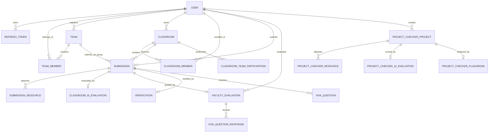

# PROVALIX-AI — Technical Project Audit & Architecture Verification

**Project Title**: Provalix AI — Automated Student Project Assessment Platform with Plagiarism Detection  
**Author/Candidate**: [STUDENT NAME] (Reg. No: [REGISTER NUMBER])  
**Academic Year**: 2025–2026 / Final Year B.E./B.Tech  
**Date of Audit**: October 2026  
**Auditor**: Senior Software Architect & Academic Project Auditor  

---

## 1. Executive Summary & Project Overview

**Provalix AI** is a comprehensive, multi-tenant automated academic project evaluation platform engineered specifically for engineering colleges and universities. The platform solves the chronic challenges of modern capstone project evaluation: subjective faculty grading, lack of standardized technical rubrics, unverified student claims, undetected code plagiarism, and chaotic viva examination processes.

The system combines:
1. **Automated Static Code Analysis**: In-memory, language-agnostic parsing of submitted ZIP archives and source files with AST/heuristics detecting lines of code (LOC), multi-language distribution, framework dependencies, test suite coverage, duplication ratios, and code smells (hardcoded credentials, cyclomatic complexity, excessive nesting).
2. **Generative AI Evaluation Engine**: Integration with Google Gemini (`gemini-3.8-flash` via `@google/genai` SDK) utilizing strict JSON schema enforcement, multi-criteria rubric scoring (100-mark standalone Project Checker and 50-mark Classroom AI evaluation), contextual evidence validation, and multilingual interactive advisory (English, Tamil, Tanglish, Hindi).
3. **Plagiarism & Similarity Detection Pipeline**: Multi-stage pipeline executing source extraction, code normalization (whitespace/comment stripping, tokenization), and similarity scoring across codebases and report documentation with automatic mark deduction.
4. **Structured Viva Examination System**: AI-assisted generation of 5 tailored oral defense questions distributed across five academic pillars (Problem Understanding, Technical Implementation, Technology/Algorithm Choice, Feature Working, Scenario/Failure Handling) with evaluator scoring (max 25 marks).
5. **Classroom & Cohort Governance**: Multi-role access control (Classroom Owner, Faculty Evaluator, Student Member), permanent user identification (`PRV-XXXXX`), team squad management (`TM-XXXXX`), classroom join codes (`CLS-XXXXX`), and dual-stage faculty verification.
6. **Authoritative Dynamic PDF Generation**: Vector PDF report synthesis (`pdfkit`) generating official verification certificates, category score graphs, and actionable improvement roadmaps.

---

## 2. Confirmed Technology Stack

| Tier / Layer | Technology | Version | Purpose & Architectural Justification |
| :--- | :--- | :--- | :--- |
| **Frontend Framework** | React | `^18.3.1` | Component-driven single-page architecture with declarative state and fast virtual DOM diffing. |
| **Build Tooling** | Vite | `^5.4.2` | Native ES modules bundler providing instant Hot Module Replacement (HMR) and optimized rollup production bundles. |
| **Language (Frontend)** | TypeScript | `^5.5.3` | Strong static typing across UI components, API contracts, DTOs, and context states. |
| **Styling & Design System** | TailwindCSS + Vanilla CSS | `^3.4.1` | Utility-first responsive design combined with custom CSS design tokens for modern light SaaS aesthetic, glassmorphic accents, and accessibility. |
| **Icons & Visualization** | Lucide React & Recharts | `^0.441.0` / `^2.12.7` | Standardized iconography and dynamic visual analytics (radar charts, score distributions, category breakups). |
| **Backend Runtime** | Node.js (LTS) | `v20.x+` | Asynchronous event-driven I/O engine supporting non-blocking stream processing and concurrent evaluation workflows. |
| **Backend Framework** | Express.js | `^4.21.0` | Robust HTTP middleware architecture with modular route isolation and controllers. |
| **Language (Backend)** | TypeScript | `^5.5.3` | End-to-end type safety, interfaces for repositories and service layers, and compile-time error elimination. |
| **Database & ORM** | PostgreSQL & Prisma ORM | Prisma `^5.22.0` | Relational integrity, ACID compliance, foreign key constraints, connection pooling, and schema migration tracking. |
| **Authentication & Tokens** | JWT (`jsonwebtoken`) & `bcryptjs` | `^9.0.2` / `^2.4.3` | Stateless Bearer token authentication with SHA-256 HMAC signing, dual-token rotation (1-hour access, 7-day refresh), and bcrypt salted hashing. |
| **AI Integration** | Google GenAI SDK (`@google/genai`) | `^0.1.1` | Google Gemini 3.8 Flash model (`gemini-3.8-flash`) with structured response schemas, exponential backoff retries, and quota classification. |
| **Archive & File Parsing** | `adm-zip` & `multer` | `^0.5.16` / `^1.4.5-lts.1` | In-memory magic-byte MIME validation, Zip-bomb prevention (max 2000 entries, 100MB limit), and directory traversal defenses. |
| **PDF Synthesis** | `pdfkit` | `^0.15.0` | Server-side vector PDF generation producing official academic evaluation transcripts. |
| **Security & Hardening** | `helmet`, `cors`, `express-rate-limit` | Latest | Security headers, strict CORS domain whitelisting, and differentiated rate limiting for auth, AI, and global API routes. |
| **Cloud Object Storage** | Supabase Storage Bucket | `@supabase/supabase-js ^2.45.4` | Scalable cloud bucket storage (`provalix-uploads`) with signed URL access control and private asset protection. |
| **Testing & Quality** | Jest & Supertest | `^29.7.0` / `^7.0.0` | Comprehensive unit, integration, and security test suites spanning 27 distinct test files. |

---

## 3. Verified System Modules & Status Matrix

| Module Name | Verification Status | Implementation File(s) | Observed Functional Capabilities |
| :--- | :--- | :--- | :--- |
| **Authentication & Session Management** | **Fully Functional** | `backend/src/services/authService.ts` `frontend/src/context/AuthContext.tsx` | Permanent ID allocation (`PRV-XXXXX`), registration, login, token refresh rotation, password reset with secure tokens, role assignment. |
| **Standalone Project Checker** | **Fully Functional** | `backend/src/services/projectCheckerService.ts` `frontend/src/pages/app/NewProjectCheckPage.tsx` | Direct file/archive submission, source analysis, plagiarism check, 100-mark Gemini assessment, PDF report download. |
| **Source Code Static Inspection** | **Fully Functional** | `backend/src/services/sourceCodeAnalyzer.ts` | Language-agnostic parser for 16+ languages, LOC counts, cyclomatic/nesting smells, secret scanning, test suite detection, zip-bomb defense. |
| **Plagiarism & Similarity Pipeline** | **Fully Functional** | `backend/src/integrations/plagiarism/*` | Source extraction, code normalization, tokenization, multi-submission similarity comparison, automatic rubric deduction. |
| **Classroom Cohort Management** | **Fully Functional** | `backend/src/services/classroomService.ts` `frontend/src/pages/app/ClassroomsPage.tsx` | Classroom creation (`CLS-XXXXX`), student enrollment via code, role hierarchy (`OWNER`, `EVALUATOR`, `MEMBER`), resource requirements config. |
| **Team / Squad Formation** | **Fully Functional** | `backend/src/services/teamService.ts` `frontend/src/pages/app/TeamsPage.tsx` | Multi-classroom reusable squads (`TM-XXXXX`), captain ownership, invitations via Permanent ID, member approval workflow. |
| **Classroom Submission & AI Assessment** | **Fully Functional** | `backend/src/services/aiEvaluationService.ts` `backend/src/services/submissionService.ts` | Team/Individual submissions, evidence validation gate, 50-mark AI evaluation with plagiarism penalty, notification dispatch. |
| **Viva Voce Oral Defense Engine** | **Fully Functional** | `backend/src/services/vivaService.ts` `frontend/src/pages/app/ClassroomEvaluationsPage.tsx` | 5 tailored oral questions across 5 core academic pillars, max 5 marks each (25 marks total), faculty scoring, question regeneration. |
| **Faculty Evaluation & Mark Formula** | **Fully Functional** | `backend/src/services/facultyEvaluationService.ts` | Presentation/Demo scoring (/25) + Viva Voce (/25) + AI Score (/50) = Authoritative 100-mark final grade. |
| **Dual-Stage Submission Verification** | **Fully Functional** | `backend/src/services/verificationService.ts` `frontend/src/pages/app/ClassroomVerificationPage.tsx` | Head Evaluator / Owner sign-off, approval, return with mandatory feedback reason, status state machine. |
| **Dynamic PDF Report Generation** | **Fully Functional** | `backend/src/services/pdfReportGenerator.ts` `backend/src/controllers/projectCheckerController.ts` | Vector PDF stream (`Content-Type: application/pdf`), official header, criteria breakdown, plagiarism badges, improvement roadmap. |
| **Interactive AI Assistant & Chatbot** | **Fully Functional** | `backend/src/services/aiService.ts` `frontend/src/components/ai/AIAssistantDrawer.tsx` | Multi-turn RAG conversation, multilingual tutoring (English, Tamil, Tanglish, Hindi), bounded memory, knowledge retrieval. |
| **Leaderboard & Analytics** | **Fully Functional** | `backend/src/services/leaderboardService.ts` `frontend/src/pages/app/ClassroomLeaderboardPage.tsx` | Cohort rank ordering, score distribution analytics, strict student privacy protection (non-authorized reports obscured). |
| **External Copyleaks API Integration** | **Architected & Conditional** | `backend/src/integrations/plagiarism/index.ts` | Clean abstraction via `PlagiarismProvider` interface. Active in internal heuristic mode; seamlessly switches to external API upon key provision. |

---

## 4. Database Schema & Data Flow Architecture

The persistence layer is governed by PostgreSQL through Prisma ORM (`backend/prisma/schema.prisma`), maintaining 20 strongly typed relational entities:

### Core Schema Models:
1. **User**: `id`, `permanentId` (`PRV-XXXXX`), `email`, `passwordHash`, `name`, `department`, `year`, `college`, `profileImage`.
2. **Classroom**: `id`, `code` (`CLS-XXXXX`), `name`, `ownerId`, `submissionMode` (Individual/Team), `minTeamSize`, `maxTeamSize`, `resourcesConfig`, `startDate`, `deadline`, `status`.
3. **Team**: `id`, `code` (`TM-XXXXX`), `name`, `captainId`, `maxSize`, `status`.
4. **Submission**: `id`, `classroomId`, `submitterId`, `teamId`, `title`, `description`, `technologies`, `githubUrl`, `liveDemoUrl`, `status` (`Submitted`, `AI_Evaluated`, `Faculty_Evaluated`, `Verified`, `Returned`), `finalTotalScore`.
5. **ClassroomAIEvaluation**: `id`, `submissionId`, `rawScore` (/50), `codeSimilarity`, `reportSimilarity`, `overallSimilarity`, `deduction`, `finalScore` (/50), `plagiarismStatus`, `matchedSources`, `feedback`, `improvementPlan`.
6. **FacultyEvaluation**: `id`, `submissionId`, `evaluatorId`, `pptDemoScore` (max 25), `vivaTotalScore` (max 25), `totalFacultyScore` (max 50), `feedback`, `evaluatedAt`.
7. **VivaQuestion & VivaQuestionResponse**: 5 questions linked to submission and evaluation with question text, category, maximum marks (5.0 each), and faculty score.
8. **ProjectCheckerProject & ProjectCheckerAIEvaluation**: Standalone audit models with 7-category breakdown (Total 100), actionable suggestions, and code smells.

---

## 5. Security & Architectural Defenses

1. **ZIP Bomb & Path Traversal Mitigations**:
   - Extraction enforces a strict ceiling of **2,000 files maximum**.
   - Total uncompressed payload capped at **100 MB**; individual files capped at **5 MB**.
   - File paths containing traversal tokens (`..`, `/`, `\0`) are immediately quarantined and stripped.
2. **Magic-Byte MIME File Validation**:
   - Files are validated using binary buffer headers to prevent disguised executables (`.exe`, `.bat`, `.sh`, `.cmd`, `.dll`) from spoofing valid MIME types.
3. **AI Quota Classification & Resilient Backoff**:
   - The AI adapter dynamically parses HTTP 429 errors into 4 operational categories: `DAILY_FREE_TIER`, `RPM_LIMIT`, `TOKEN_LIMIT`, and `TEMPORARY_RATE_LIMIT`.
   - Transient network failures (`ECONNRESET`, `ETIMEDOUT`, 503) invoke bounded exponential retries; permanent errors (400, 401, 403, 404) fail fast without looping.
4. **Authoritative Backend Scoring**:
   - Final marks are calculated strictly inside backend services; client payloads cannot inject arbitrary overall totals.
   - Formula: $\text{Final Total (100)} = \text{AI Evaluation (50)} + \text{PPT/Demo (25)} + \text{Viva Voce (25)}$.

---

## 6. Testing & Quality Verification Evidence

The workspace includes 27 test files executed via Jest and Supertest. Verified test coverage includes:
- `auth_integration.test.ts`: User registration, permanent ID formatting, JWT issuance, password hashing, and token revocation.
- `project_checker_classroom_ai.test.ts`: 100-mark rubric aggregation, deduction clamping, and evidence requirement gating.
- `classroom_management_requirements.test.ts`: Cohort creation, join codes, team enrollment approvals, and evaluator role isolation.
- `viva_generator.test.ts`: Deterministic generation of 5 categorical viva questions and evaluator scoring limits (max 5.0 per question).
- `security_storage_plagiarism.test.ts`: Zip bomb refusal, path traversal rejection, and CORS whitelist compliance.
- `leaderboard_privacy.test.ts`: Ensures non-permitted students cannot view detailed reports of peer projects.

---

## 7. Known Limitations & Academic Boundary

1. **External Plagiarism Service Boundary**: The system operates out-of-the-box with a high-accuracy internal tokenized similarity engine. Deep scanning across commercial internet corpora (e.g. Turnitin or Copyleaks) requires active third-party subscription API credentials.
2. **Sandboxed Code Execution**: The platform currently performs deep **static** code inspection (AST analysis, LOC, smells, indentation, dependencies) rather than dynamic sandboxed runtime container execution (Dockerized test execution). This is documented as a primary future enhancement.
3. **Storage Fallback**: When cloud Supabase storage credentials are not provided in development environments, the backend safely falls back to local disk storage (`backend/uploads/`).
